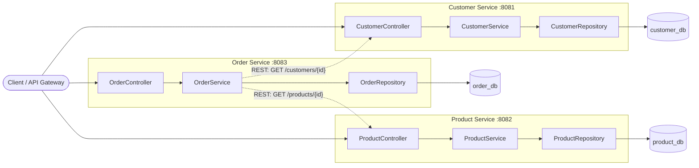
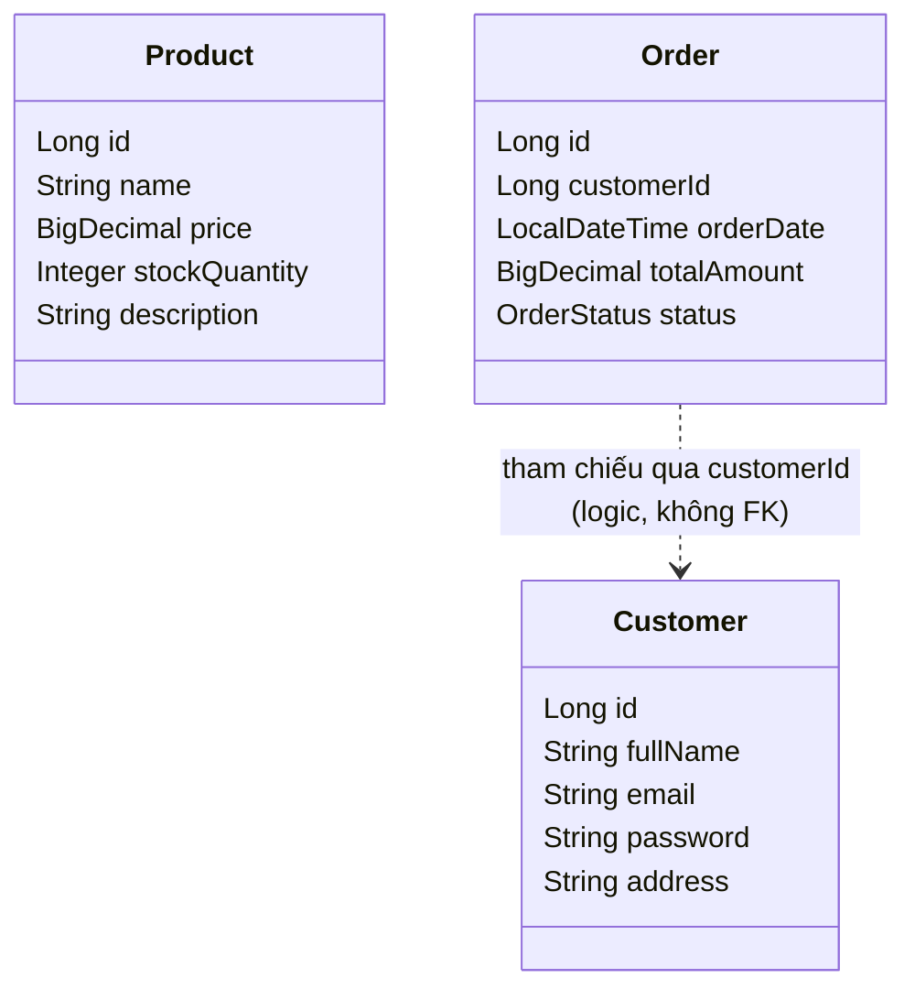
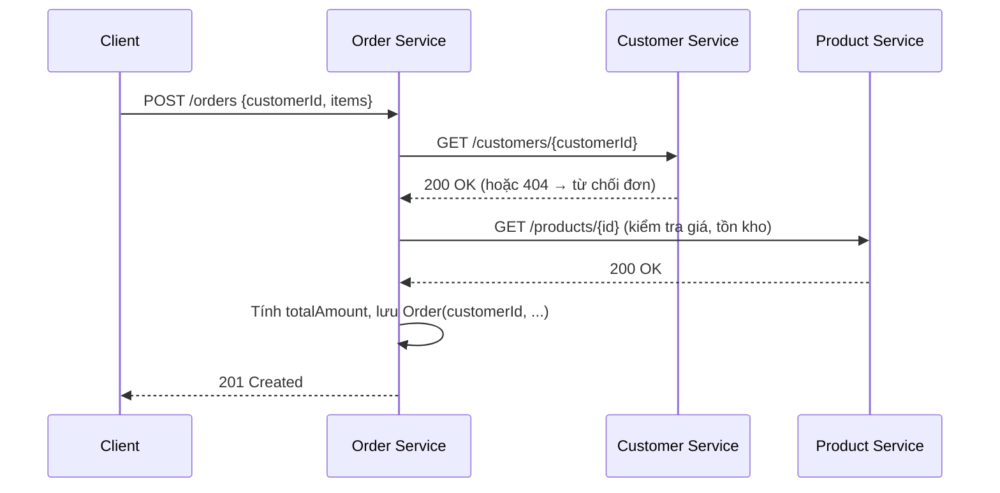

# Thiết kế kiến trúc phân rã (Decomposition) – Hệ thống TMĐT

## 1. Mục tiêu

Phân tách hệ thống TMĐT monolith thành 3 project Spring Boot độc lập, áp dụng:
- **Phân tách module (S1-L4):** mỗi service là một đơn vị triển khai riêng, có code, build và database riêng.
- **Tư duy DDD (S1-L3):** mỗi service tương ứng một Bounded Context, sở hữu thực thể và dữ liệu của chính nó.

## 2. Sơ đồ tổng quan



- Đường **liền**: luồng gọi nội bộ trong một service.
- Đường **đứt nét**: giao tiếp liên service duy nhất được phép – qua **REST API (HTTP)**, không gọi trực tiếp code/class và không truy vấn chéo database.

## 3. Thiết kế thực thể từng service

### 3.1 Customer Service (`customer-service`, DB: `customer_db`)

| Thuộc tính | Kiểu | Ràng buộc |
|---|---|---|
| id | Long | PK, auto-generated |
| fullName | String | NOT NULL |
| email | String | NOT NULL, UNIQUE |
| password | String | NOT NULL (lưu dạng hash BCrypt) |
| address | String | |

### 3.2 Product Service (`product-service`, DB: `product_db`)

| Thuộc tính | Kiểu | Ràng buộc |
|---|---|---|
| id | Long | PK, auto-generated |
| name | String | NOT NULL |
| price | BigDecimal | NOT NULL, > 0 |
| stockQuantity | Integer | NOT NULL, >= 0 |
| description | String | |

### 3.3 Order Service (`order-service`, DB: `order_db`)

| Thuộc tính | Kiểu | Ràng buộc |
|---|---|---|
| id | Long | PK, auto-generated |
| customerId | Long | NOT NULL – **chỉ là ID tham chiếu, không có FK** |
| orderDate | LocalDateTime | NOT NULL |
| totalAmount | BigDecimal | NOT NULL |
| status | Enum (PENDING, CONFIRMED, SHIPPED, CANCELLED) | NOT NULL |



> Lưu ý: yêu cầu đề bài chỉ định Order gồm `id, customerId, orderDate, totalAmount, status`. Chi tiết dòng hàng (OrderItem: productId, quantity, unitPrice) là mở rộng tuỳ chọn, nếu có thì cũng thuộc Order Service và chỉ lưu `productId` (không lưu đối tượng Product).

## 4. Ranh giới (Boundaries) giữa các service

| Quy tắc | Cách thực hiện |
|---|---|
| Không dùng chung database | Mỗi service một schema/DB riêng (`customer_db`, `product_db`, `order_db`), user DB riêng, không JOIN chéo. |
| Không gọi trực tiếp vào code của nhau | 3 project Maven/Gradle độc lập, **không** khai báo dependency lẫn nhau, không chia sẻ entity/class. |
| Giao tiếp | Chỉ qua REST API (có thể nâng cấp lên message broker sau). Mỗi service tự định nghĩa DTO riêng. |
| Sở hữu dữ liệu | Chỉ service chủ sở hữu mới được ghi dữ liệu của thực thể đó. |

### Ví dụ luồng tạo đơn hàng



## 5. Vì sao Order chỉ lưu `customerId` mà không lưu cả đối tượng `Customer`?

1. **Tuân thủ ranh giới Bounded Context (DDD):** `Customer` thuộc ngữ cảnh Customer. Order chỉ cần *biết ai đặt hàng*, không cần sở hữu hay quản lý thông tin khách hàng. Tham chiếu giữa các Aggregate khác ngữ cảnh nên theo **ID**, không theo object reference.
2. **Loose coupling (lỏng lẻo):** nếu Order nhúng `Customer`, thay đổi cấu trúc Customer (thêm/đổi field) sẽ buộc Order Service sửa và deploy lại. Chỉ giữ ID thì hai service tiến hoá độc lập.
3. **Không chia sẻ database / không có FK chéo:** vì DB tách riêng, không thể có khoá ngoại tới bảng `customer`; lưu ID là cách tham chiếu duy nhất khả thi.
4. **Single source of truth, tránh dữ liệu cũ (stale/inconsistent):** nếu sao chép fullName/address vào Order, khi khách đổi địa chỉ thì dữ liệu hai nơi lệch nhau. Customer Service là nguồn sự thật duy nhất; cần thông tin thì gọi API bằng `customerId`.
5. **Bảo mật:** đối tượng Customer chứa `password`. Lưu/truyền cả đối tượng sang Order sẽ làm lộ dữ liệu nhạy cảm ra ngoài ngữ cảnh không cần thiết.
6. **Khả năng mở rộng & độc lập triển khai:** mỗi service scale, deploy, đổi công nghệ lưu trữ riêng; lỗi ở service này không kéo theo hỏng schema của service kia.
7. **Gọn nhẹ:** Order chỉ lưu một giá trị `Long`, tránh nhân bản dữ liệu và payload lớn.

**Đánh đổi:** hiển thị chi tiết đơn hàng kèm tên khách cần thêm một lời gọi REST (hoặc API Composition/cache). Đây là chi phí chấp nhận được so với lợi ích về độc lập và nhất quán dữ liệu. Nếu cần "chụp lại" thông tin tại thời điểm đặt (ví dụ địa chỉ giao hàng), lưu **snapshot** có chủ đích trong Order (như `shippingAddress`) chứ không lưu cả đối tượng Customer.

## 6. Cấu trúc project đề xuất

```
customer-service/   (port 8081, customer_db)
product-service/    (port 8082, product_db)
order-service/      (port 8083, order_db)
```
Mỗi project có cấu trúc: `controller` → `service` → `repository` → `entity`, cùng `dto` và `application.properties` riêng.
